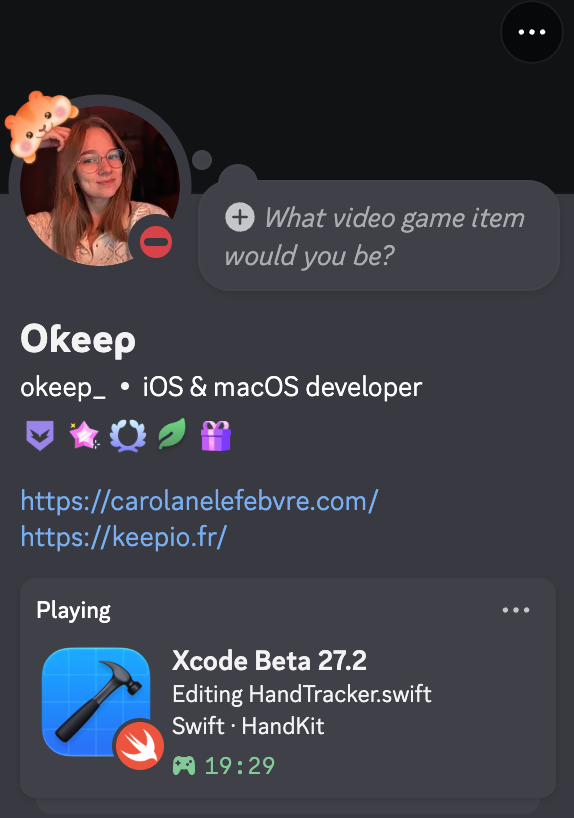

# Xcode Presence

Une petite application macOS dans la barre des menus pour afficher ton activité Xcode sur Discord : fichier actif, projet, langage et durée de session.

[English](README.md) · [Contribuer](CONTRIBUTING.md) · [Licence MIT](LICENSE)

<p align="center">
  
</p>

## Fonctionnalités

- Xcode et Xcode Beta, avec le nom et la version du logiciel actif.
- Fichier enregistré, projet ou package Swift, langage et badge, durée de session.
- Conservation du dernier fichier dans Coding Assistant et les panneaux sans document.
- Masquage indépendant du fichier, du projet, du langage et du compteur.
- Pause manuelle, partage au premier plan seulement, pause après 5, 15 ou 30 minutes d’inactivité.
- Français, anglais ou langue automatique de macOS.
- Application dans la barre des menus, sans icône dans le Dock.
- Connexion locale à Discord, sans token de compte ni bot.

## Télécharger l’application

[Télécharger Xcode Presence 0.3.1 pour macOS](https://github.com/CarolaneLFBV/xcode-discord-presence/releases/download/v0.3.1/XcodePresence-0.3.1-universal.dmg) — DMG universel Apple Silicon + Intel, signé avec Developer ID et notarisé par Apple.

Ouvre le DMG, glisse **Xcode Presence** dans **Applications**, puis lance l’app. Aucune compilation n’est nécessaire. Suis ensuite la section [Configurer Discord](#configurer-discord) pour renseigner l’Application ID public et accorder l’autorisation Accessibilité. La release fournit aussi `SHA256SUMS.txt` pour vérifier le téléchargement.

## Compiler depuis les sources

Prérequis : macOS 13 ou ultérieur, Xcode installé et Discord pour Mac. Pour compiler : Xcode 15 / Swift 5.9 ou ultérieur. Les environnements effectivement vérifiés sont indiqués dans [VALIDATION.md](VALIDATION.md).

Télécharge ou clone le dépôt, puis ouvre un Terminal à sa racine :

```sh
./scripts/test.sh
./scripts/build.sh
open dist
```

Le script crée **Xcode Presence.app** et son ZIP dans `dist`. Quitte l’ancienne copie si nécessaire, déplace la nouvelle application dans **Applications**, puis ouvre-la. Conserve une seule copie installée pour éviter les présences en double et les autorisations ambiguës.

Cette compilation de développement produit l’architecture de ton Mac et une signature locale, sans notarisation. Pour installer sans compiler, utilise le DMG signé et notarisé ci-dessus. Ouvre `Package.swift` dans Xcode pour parcourir et modifier les sources. Le processus de distribution des mainteneurs est décrit dans [DISTRIBUTION.md](DISTRIBUTION.md).

Si le dossier source est synchronisé, utilise le ZIP généré pour déplacer l’application dans Applications. Il est créé depuis un bundle signé temporaire pour éviter les métadonnées Finder ajoutées par certains fournisseurs de fichiers.

## Configurer Discord

1. Crée une application dans le [portail développeur Discord](https://discord.com/developers/applications), par exemple nommée **Xcode**.
2. Copie son **Application ID** depuis General Information. Cet identifiant numérique est public ; ce n’est pas un token.
3. Dans le menu de Xcode Presence, ouvre les réglages, puis **Connexion**. Colle l’identifiant et clique sur **Enregistrer**.
4. Clique sur **Ouvrir les autorisations macOS**, puis autorise l’application d’Applications dans **Confidentialité et sécurité → Accessibilité**. Sur certaines bêtas macOS, cette page se nomme **Device Control and Data Access**.
5. Garde Discord pour Mac ouvert, active son partage d’activité et sélectionne un fichier enregistré dans Xcode.

La page **Ton activité** indique l’autorisation macOS, le fichier détecté et la confirmation de réception par Discord. La visibilité du profil dépend aussi des réglages de partage d’activité de ton compte Discord.

Après remplacement d’un build signé localement, macOS peut demander de retirer uniquement l’ancienne entrée Xcode Presence, puis d’ajouter la copie d’Applications. Cette autorisation reste à valider manuellement.

## Contrôler le partage

Dans **Partage**, choisis les champs affichés et les règles de pause. Par défaut, tous les champs sont affichés, le partage continue en arrière-plan et la pause pour inactivité est désactivée. Le compteur conserve le début de la session pendant les pauses et reconnexions.

Le code source et les chemins complets ne sont pas envoyés à Discord. Seules les métadonnées activées sont partagées via le client local. Les requêtes en attente ou encore en connexion sont annulées après un changement de confidentialité ; une trame déjà reçue par Discord ne peut pas être rappelée. Les détails sont dans [ARCHITECTURE.md](ARCHITECTURE.md).

## Développer et contribuer

```sh
./scripts/build.sh --preview
open "dist/Xcode Presence Preview.app"
./scripts/format.sh
./scripts/format.sh --check
```

L’aperçu utilise des exemples génériques et des préférences séparées, sans connexion Discord. Aucun package Swift externe n’est requis. Voir [CONTRIBUTING.md](CONTRIBUTING.md) pour les vérifications et [README.md](README.md#troubleshooting) pour le dépannage et les diagnostics.

Après avoir validé et commité les fichiers destinés au public, `./scripts/export-public.sh` crée un ZIP du code courant sans l’ancien historique Git, les fichiers ignorés ou les builds. Cet export peut servir à initialiser un dépôt public neuf. Aucun script ne crée de dépôt distant et aucun envoi n’est effectué.

Le code est sous [licence MIT](LICENSE). Les logos de langages conservent leur licence CC-BY-4.0 ; les attributions et le statut des icônes sont détaillés dans [NOTICE.md](NOTICE.md). La capture a été fournie par la mainteneuse pour ce README. Projet indépendant, sans affiliation ni approbation d’Apple, Discord ou GitHub.
