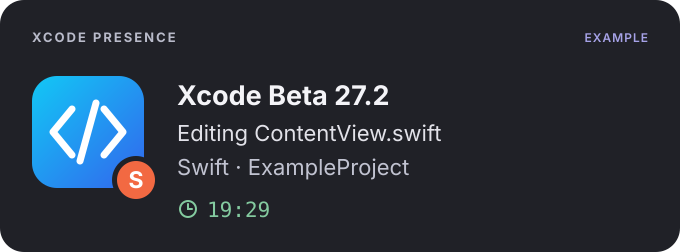

# Xcode Presence

A small native macOS menu bar app that shares your Xcode activity on Discord: the current file, project, programming language and session duration.

[Français](README.fr.md) · [Contributing](CONTRIBUTING.md) · [MIT license](LICENSE)

<p align="center">
  
</p>

Illustrative activity with sample data; no personal profile is shown.

## Features

- Supports Xcode and Xcode Beta; the title follows the running application's product version.
- Shows the active saved file, project or Swift package, language badge and elapsed session time.
- Keeps the last detected file while you use Coding Assistant or another documentless panel.
- Lets you hide the file, project, language or timer independently.
- Manual pause, optional foreground-only sharing, and inactivity timeouts of 5, 15 or 30 minutes.
- French, English and automatic macOS language selection.
- Runs in the menu bar without a Dock icon. Closing its settings window keeps it running.
- Connects locally to Discord. No Discord account token, password or bot is required.

## Requirements

- macOS 13 or later.
- Xcode installed, and the Discord desktop app running on the same Mac.
- To build from source: Xcode 15 / Swift 5.9 or later. Current local validation and the limits of compatibility testing are documented in [VALIDATION.md](VALIDATION.md).

The build targets the architecture of the Mac used to compile it. The CI configuration covers Apple Silicon and Intel on stable Xcode versions; a hosted CI run will only happen after the project is published.

## Install from source

Download or clone this repository, then open Terminal in its root folder:

```sh
./scripts/test.sh
./scripts/build.sh
open dist
```

The build creates `dist/Xcode Presence.app` and `dist/Xcode Presence.zip`. Quit any running copy, then move the app into **Applications** and open it. Keep one installed copy to avoid duplicate presences and ambiguous macOS permissions.

The application is signed locally, not notarized for general distribution. Building locally is the supported installation path for this repository. No release download is assumed or linked here.

If your source folder is synced by a file provider, use the generated ZIP to move the app into Applications. The build signs a temporary bundle and archives it without Finder metadata that could interfere with signature validation.

You can also open `Package.swift` in Xcode to browse and edit the sources. Use the build script to assemble the complete application bundle and its icons and guide.

## Connect Discord

1. Open the [Discord Developer Portal](https://discord.com/developers/applications) and create an application. A name such as **Xcode** works well.
2. Copy its **Application ID** from General Information. This is a public numeric identifier, not a token.
3. Open Xcode Presence from its menu bar icon. In **Connection**, paste the ID and click **Save**.
4. Choose **Open macOS permissions**, then allow the installed Xcode Presence app in **Privacy & Security → Accessibility**. Some macOS beta versions call this page **Device Control and Data Access**.
5. Keep Discord for Mac open with activity sharing enabled, then select a saved file in Xcode.

The Activity page shows whether macOS access is allowed, a file is detected and Discord has confirmed receipt. Profile visibility also depends on your Discord account's activity-sharing settings.

After replacing a locally signed build, macOS may require you to remove only the old Xcode Presence entry and add the copy in Applications again. The app never grants itself that permission.

## Sharing and privacy

All display fields are enabled initially. Sharing continues in the background, with inactivity pausing disabled by default. Change these preferences in **Sharing**. Pauses and reconnects preserve the start of the Xcode session.

Only enabled display fields are sent to the local Discord client. Source code and full file paths are not included in the activity payload. The app reads document metadata through macOS Accessibility; it does not read the source editor's text value. Discord may fetch language artwork from GitHub and the Xcode artwork URL from Apple.

Changing privacy settings cancels queued requests and requests still waiting for Discord's connection handshake. A frame already delivered to Discord cannot be recalled; the next clear or update follows the bounded in-flight operation. See [ARCHITECTURE.md](ARCHITECTURE.md).

## Development

```sh
# Render the same interface with generic sample data and separate preferences.
# This preview never connects to Discord.
./scripts/build.sh --preview
open "dist/Xcode Presence Preview.app"

# Format Swift files, then verify formatting (swift-format required).
./scripts/format.sh
./scripts/format.sh --check
```

There are no third-party Swift package dependencies. `PresenceCore` contains the display models, sharing rules and Discord transport. `XcodePresence` contains the macOS integration, preferences, localization and SwiftUI screens.

See [CONTRIBUTING.md](CONTRIBUTING.md) for development checks and [ARCHITECTURE.md](ARCHITECTURE.md) for the source layout and concurrency model. `./scripts/backup-sources.sh` creates a local source archive outside the project; it does not publish or upload anything.

`./scripts/export-public.sh` exports the committed public tree to a ZIP without `.git` history, ignored files or build products. It requires a clean working tree. This is useful when a local project's earlier commits contained private examples or assets that are no longer distributed. Import that export into a fresh repository when preparing an initial public release; no script creates a remote or pushes anything.

## Troubleshooting

- **No file detected:** allow Accessibility access, then select a saved source file. Some Xcode panels do not expose a document; the last detected file is retained until another is selected or that Xcode process exits.
- **Discord not found:** open the desktop app. A browser-only Discord session does not expose the required local IPC socket.
- **Activity received but not visible:** check Discord's account and per-server activity-sharing preferences.
- **No language badge:** unknown file types may have a label without an icon. The activity's main icon still identifies Xcode.
- **Xcode Beta 27.2:** `27.2` is the product version, not a beta sequence number.

For local metadata diagnostics, run:

```sh
"dist/Xcode Presence.app/Contents/MacOS/XcodePresence" --diagnose
"dist/Xcode Presence.app/Contents/MacOS/XcodePresence" --ipc-check
```

The first prints permission and document metadata, which you should review before sharing a log. The second verifies Discord's handshake and a clear-command acknowledgement without publishing sample activity. Command-line execution may have a different macOS permission context from a normally launched app.

## License and artwork

Source code is available under the [MIT license](LICENSE). Language logos retain their upstream CC-BY-4.0 license and attribution. The app obtains its Xcode icon from an installed copy of Xcode rather than bundling an Apple bitmap. See [NOTICE.md](NOTICE.md) and the bundled [third-party notices](Resources/ThirdPartyNotices.txt).

The illustration above uses generic sample data. This project is an independent utility and is not affiliated with or endorsed by Apple, Discord or GitHub.
